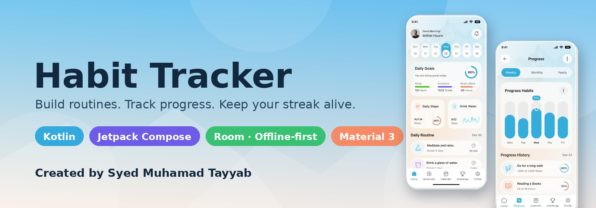
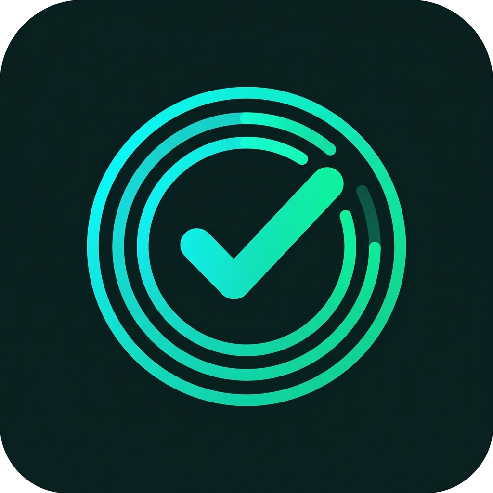
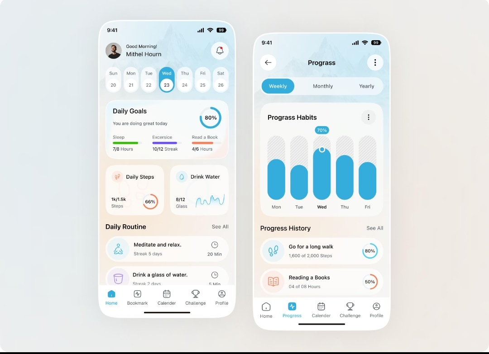

<div align="center">



<br/>



# 🌤️ Habit Tracker

**A beautiful, offline-first Android habit tracker built with Jetpack Compose.**
Track daily routines, water, steps, sleep & reading — see your progress by week, month and year, and keep your streak alive.

<p>
  
  
  
  
  
</p>

</div>

---

## 📑 Table of contents
- [✨ Features](#-features)
- [📱 Screens](#-screens)
- [🧰 Tech stack](#-tech-stack)
- [🚀 Getting started](#-getting-started)
- [🤖 AI Coach (optional)](#-ai-coach-optional)
- [🗂️ Project structure](#️-project-structure)
- [🔐 Data & privacy](#-data--privacy)
- [🧪 Tests](#-tests)
- [🗺️ Roadmap](#️-roadmap)
- [👤 Author](#-author)

## ✨ Features

| | |
|---|---|
| 🏠 **Daily dashboard** | Week strip, a daily-goals ring, and tap-to-complete routines (long-press to edit) |
| 💧 **Quick trackers** | Steps and water cards with a 7-day water trend, sleep and reading goals |
| 📊 **Progress charts** | Weekly / Monthly / Yearly hatched bar charts with a live percentage marker |
| 🗓️ **Calendar** | Month grid with a completion ring per day, per-day habit list, month summary & habit ranking |
| 🏆 **Challenges** | 7 / 21 / 30-day streaks, Perfect Week, Hydration Hero, Step Master — calculated from your own data |
| 🔥 **Real streaks** | Consecutive-day streaks that correctly span month boundaries |
| 👤 **Accounts** | Guest mode or a unique ID (`HT-XXXXXX`) with a hashed password, all on-device |
| 🎨 **3 themes** | Sky (default), Night and Sunset |
| 🤖 **AI Habit Coach** | Personalised tips from Gemini based on your recorded progress *(optional)* |
| 📴 **Offline-first** | Everything is stored locally in a Room (SQLite) database |

## 📱 Screens

<div align="center">
  
  <br/><sub>Design reference — Home &amp; Progress. Calendar, Challenge and Profile follow the same style.</sub>
</div>

Bottom navigation: **Home · Progress · Calendar · Challenge · Profile**

## 🧰 Tech stack

- **Language:** Kotlin
- **UI:** Jetpack Compose + Material 3, custom `Canvas` charts and rings
- **Architecture:** MVVM (`ViewModel` + `StateFlow`) with a repository layer
- **Storage:** Room (SQLite) + SharedPreferences (session & theme)
- **Concurrency:** Kotlin Coroutines & Flow
- **Networking (optional):** OkHttp → Gemini API
- **Build:** Gradle (Kotlin DSL), version catalog, KSP

## 🚀 Getting started

**Requirements:** [Android Studio](https://developer.android.com/studio) (latest), Android SDK 36, an emulator or phone running Android 8.0+ (API 26).

```bash
# 1. Clone
git clone https://github.com/<your-username>/<repo-name>.git
cd <repo-name>

# 2. Build & install on a connected device / emulator
./gradlew installDebug        # Windows: gradlew.bat installDebug
```

Or: **File → Open** the folder in Android Studio, wait for Gradle sync, then press ▶ **Run**.

## 🤖 AI Coach (optional)

1. Get a key from [Google AI Studio](https://aistudio.google.com/).
2. Create a `.env` file next to `settings.gradle.kts`:
   ```properties
   GEMINI_API_KEY=your_key_here
   ```
3. Rebuild. Open **Challenge → AI Habit Coach** (or **Profile → AI Habit Coach**).

> `.env` is git-ignored — never commit your key.

## 🗂️ Project structure

```text
app/src/main/java/com/example/
├── MainActivity.kt              # Tabs, bottom bar, theme / system-bar handling
├── data/
│   ├── local/                   # Room entities, DAOs, database
│   ├── repository/              # HabitRepository, session & security helpers
│   ├── stats/HabitStats.kt      # Streak / ratio maths (pure Kotlin, unit-tested)
│   └── ai/GeminiHabitCoach.kt   # Optional AI coach client
└── ui/
    ├── components/              # GlassCard, RingProgress, bottom bar, …
    ├── screens/                 # Home, Progress, Calendar, Challenge, Profile, AI Coach
    ├── theme/                   # Colours, design tokens, Material theme
    └── viewmodel/HabitViewModel.kt
```

## 🔐 Data & privacy

All habits, history, goals and accounts live **only on your device**. Passwords are stored as SHA-256 hashes.
The only network call is the optional AI Coach prompt (habit summary → Gemini) and only if you add an API key.
You can export everything as JSON or delete it from **Profile → Data**.

## 🧪 Tests

```bash
./gradlew testDebugUnitTest
```

## 🗺️ Roadmap
- [ ] Reminders / notifications at a chosen time
- [ ] Home-screen widget
- [ ] Cloud backup & restore
- [ ] Per-habit custom schedules (weekdays only, etc.)
- [ ] Dark-mode charts polish

## 👤 Author

<table>
  <tr>
    <td align="center" width="140">
      
    </td>
    <td>
      <h3>Syed Muhamad Tayyab</h3>
      <p>Computer Science student · Android &amp; web developer · cybersecurity enthusiast</p>
      <p><b>Created with ❤️ by Syed Muhamad Tayyab</b></p>
    </td>
  </tr>
</table>

<div align="center">

If you like this project, please ⭐ the repo!

<sub>© 2026 Syed Muhamad Tayyab · Released under the MIT License</sub>

</div>
